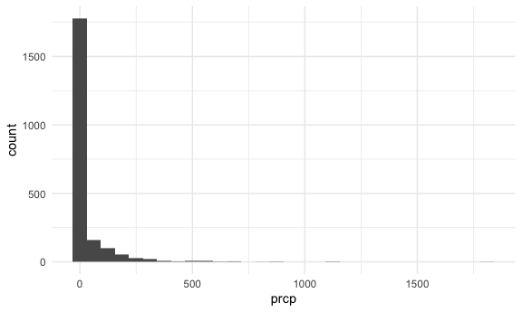
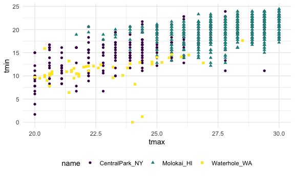
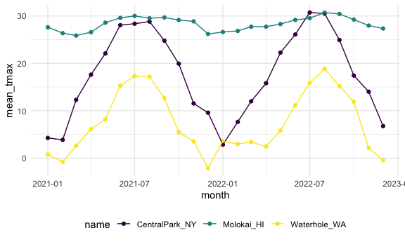
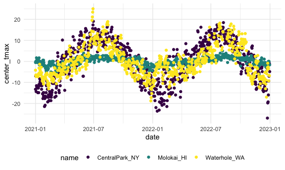

Numerical EDA
================

Load the weather data as well.

``` r
data("weather_df")
```

Now we have everything we need!

``` r
weather_df |>
  ggplot(aes(x=prcp))+
  geom_histogram ()
```

    ## `stat_bin()` using `bins = 30`. Pick better value `binwidth`.

    ## Warning: Removed 15 rows containing non-finite outside the scale range
    ## (`stat_bin()`).



``` r
weather_df |>
  filter (prcp >1000)
```

    ## # A tibble: 3 × 6
    ##   name           id          date        prcp  tmax  tmin
    ##   <chr>          <chr>       <date>     <dbl> <dbl> <dbl>
    ## 1 CentralPark_NY USW00094728 2021-08-21  1130  27.8  22.8
    ## 2 CentralPark_NY USW00094728 2021-09-01  1811  25.6  17.2
    ## 3 Molokai_HI     USW00022534 2022-12-18  1120  23.3  18.9

``` r
weather_df |> 
  filter(tmax >= 20, tmax <= 30) |> 
  ggplot(aes(x = tmax, y = tmin, color = name, shape = name)) + 
  geom_point()
```



``` r
data ("weather_df")

weather_df= weather_df |>
  mutate(
    month=lubridate::floor_date(date, unit= "month")
  )
```

Lubridate package helpful for dates and times. Pretty much round down by
month.

# `group_by()`

add some groups!

``` r
weather_df |>
  group_by(name, month) |>
  summarize(count=n ())
```

    ## `summarise()` has regrouped the output.
    ## ℹ Summaries were computed grouped by name and month.
    ## ℹ Output is grouped by name.
    ## ℹ Use `summarise(.groups = "drop_last")` to silence this message.
    ## ℹ Use `summarise(.by = c(name, month))` for per-operation grouping
    ##   (`?dplyr::dplyr_by`) instead.

    ## # A tibble: 72 × 3
    ## # Groups:   name [3]
    ##    name           month      count
    ##    <chr>          <date>     <int>
    ##  1 CentralPark_NY 2021-01-01    31
    ##  2 CentralPark_NY 2021-02-01    28
    ##  3 CentralPark_NY 2021-03-01    31
    ##  4 CentralPark_NY 2021-04-01    30
    ##  5 CentralPark_NY 2021-05-01    31
    ##  6 CentralPark_NY 2021-06-01    30
    ##  7 CentralPark_NY 2021-07-01    31
    ##  8 CentralPark_NY 2021-08-01    31
    ##  9 CentralPark_NY 2021-09-01    30
    ## 10 CentralPark_NY 2021-10-01    31
    ## # ℹ 62 more rows

The tibble shows us that there are three groups by name. Grouping doesnt
change our dataset, but know that its there. Can group and ungroup
intentionally.

``` r
weather_df |> 
  count(name, month)
```

    ## # A tibble: 72 × 3
    ##    name           month          n
    ##    <chr>          <date>     <int>
    ##  1 CentralPark_NY 2021-01-01    31
    ##  2 CentralPark_NY 2021-02-01    28
    ##  3 CentralPark_NY 2021-03-01    31
    ##  4 CentralPark_NY 2021-04-01    30
    ##  5 CentralPark_NY 2021-05-01    31
    ##  6 CentralPark_NY 2021-06-01    30
    ##  7 CentralPark_NY 2021-07-01    31
    ##  8 CentralPark_NY 2021-08-01    31
    ##  9 CentralPark_NY 2021-09-01    30
    ## 10 CentralPark_NY 2021-10-01    31
    ## # ℹ 62 more rows

``` r
weather_df |> 
  group_by(month) |>
  summarize(
    count= n(),
    n_days=n_distinct(date)
  )
```

    ## # A tibble: 24 × 3
    ##    month      count n_days
    ##    <date>     <int>  <int>
    ##  1 2021-01-01    93     31
    ##  2 2021-02-01    84     28
    ##  3 2021-03-01    93     31
    ##  4 2021-04-01    90     30
    ##  5 2021-05-01    93     31
    ##  6 2021-06-01    90     30
    ##  7 2021-07-01    93     31
    ##  8 2021-08-01    93     31
    ##  9 2021-09-01    90     30
    ## 10 2021-10-01    93     31
    ## # ℹ 14 more rows

DONT DO THIS

``` r
weather_df |> 
  pull(tmax) |>
  summary()
```

Don’t do summary it is very old base r package, seems handy, but what
are you going to do with this.

Do this Instead

``` r
weather_df |>
  group_by(name) |>
  summarize (
    mean_tamax= mean(tmax, na.rm= TRUE), 
    mediant_tmax= median(tmax, na.rm= TRUE),
    sd_prcp= sd(prcp, na.rm= TRUE)
  )
```

    ## # A tibble: 3 × 4
    ##   name           mean_tamax mediant_tmax sd_prcp
    ##   <chr>               <dbl>        <dbl>   <dbl>
    ## 1 CentralPark_NY      17.7          18.9   113. 
    ## 2 Molokai_HI          28.3          28.3    63.2
    ## 3 Waterhole_WA         7.38          6.1   111.

You can summarize however you want to

``` r
weather_df |>
  group_by(name) |>
  summarize (
    mean_tamax= mean(tmax, na.rm= TRUE), 
    mediant_tmax= median(tmax, na.rm= TRUE),
    sd_prcp= sd(prcp, na.rm= TRUE),
    q95_prcp= quantile (prcp, 0.95, na.rm= TRUE)
  )
```

    ## # A tibble: 3 × 5
    ##   name           mean_tamax mediant_tmax sd_prcp q95_prcp
    ##   <chr>               <dbl>        <dbl>   <dbl>    <dbl>
    ## 1 CentralPark_NY      17.7          18.9   113.       198
    ## 2 Molokai_HI          28.3          28.3    63.2       41
    ## 3 Waterhole_WA         7.38          6.1   111.       279

``` r
weather_df |>
  group_by(name, month) |>
  summarise (
    mean_tmax= mean(tmax, na.rm= TRUE), 
  ) |>
  pivot_wider(
    names_from= name,
    values_from= mean_tmax
  ) |>
  knitr::kable(digits=2)
```

    ## `summarise()` has regrouped the output.
    ## ℹ Summaries were computed grouped by name and month.
    ## ℹ Output is grouped by name.
    ## ℹ Use `summarise(.groups = "drop_last")` to silence this message.
    ## ℹ Use `summarise(.by = c(name, month))` for per-operation grouping
    ##   (`?dplyr::dplyr_by`) instead.

| month      | CentralPark_NY | Molokai_HI | Waterhole_WA |
|:-----------|---------------:|-----------:|-------------:|
| 2021-01-01 |           4.27 |      27.62 |         0.80 |
| 2021-02-01 |           3.87 |      26.37 |        -0.79 |
| 2021-03-01 |          12.29 |      25.86 |         2.62 |
| 2021-04-01 |          17.61 |      26.57 |         6.10 |
| 2021-05-01 |          22.08 |      28.58 |         8.20 |
| 2021-06-01 |          28.06 |      29.59 |        15.25 |
| 2021-07-01 |          28.35 |      29.99 |        17.34 |
| 2021-08-01 |          28.81 |      29.52 |        17.15 |
| 2021-09-01 |          24.79 |      29.67 |        12.65 |
| 2021-10-01 |          19.93 |      29.13 |         5.48 |
| 2021-11-01 |          11.54 |      28.85 |         3.53 |
| 2021-12-01 |           9.59 |      26.19 |        -2.10 |
| 2022-01-01 |           2.85 |      26.61 |         3.61 |
| 2022-02-01 |           7.65 |      26.83 |         2.99 |
| 2022-03-01 |          11.99 |      27.73 |         3.42 |
| 2022-04-01 |          15.81 |      27.72 |         2.46 |
| 2022-05-01 |          22.25 |      28.28 |         5.81 |
| 2022-06-01 |          26.09 |      29.16 |        11.13 |
| 2022-07-01 |          30.72 |      29.53 |        15.86 |
| 2022-08-01 |          30.50 |      30.70 |        18.83 |
| 2022-09-01 |          24.92 |      30.41 |        15.21 |
| 2022-10-01 |          17.43 |      29.22 |        11.88 |
| 2022-11-01 |          14.02 |      27.96 |         2.14 |
| 2022-12-01 |           6.76 |      27.35 |        -0.46 |

``` r
weather_df |>
  group_by(name, month) |>
  summarise (
    mean_tmax= mean(tmax, na.rm= TRUE), 
  ) |>
  ggplot(aes(x=month, y=mean_tmax, color=name))+
  geom_point()+
  geom_line ()
```

    ## `summarise()` has regrouped the output.
    ## ℹ Summaries were computed grouped by name and month.
    ## ℹ Output is grouped by name.
    ## ℹ Use `summarise(.groups = "drop_last")` to silence this message.
    ## ℹ Use `summarise(.by = c(name, month))` for per-operation grouping
    ##   (`?dplyr::dplyr_by`) instead.



``` r
weather_df |>
  group_by(name)|>
  mutate(center_tmax=tmax - mean(tmax, na.rm=TRUE)) |>
ggplot(aes(x=date, y=center_tmax, color=name)) +
geom_point()
```

    ## Warning: Removed 17 rows containing missing values or values outside the scale range
    ## (`geom_point()`).


Sometimes its helpful to center your variables and compute avg tmax and
subtract it from the center. Mutate knows when you add in the group by
computes the group specific mean and what not.

What about “window functions”. Try to rank things

``` r
weather_df |>
  group_by (name, month) |>
  mutate(temp_rank= min_rank(desc(tmax))) |>
  filter(temp_rank <2)
```

    ## # A tibble: 104 × 8
    ## # Groups:   name, month [72]
    ##    name           id          date        prcp  tmax  tmin month      temp_rank
    ##    <chr>          <chr>       <date>     <dbl> <dbl> <dbl> <date>         <int>
    ##  1 CentralPark_NY USW00094728 2021-01-02    13  10.6   2.2 2021-01-01         1
    ##  2 CentralPark_NY USW00094728 2021-02-24     0  12.2   3.9 2021-02-01         1
    ##  3 CentralPark_NY USW00094728 2021-03-26    48  27.8  11.1 2021-03-01         1
    ##  4 CentralPark_NY USW00094728 2021-04-28    13  29.4  11.1 2021-04-01         1
    ##  5 CentralPark_NY USW00094728 2021-05-22     0  31.7  18.3 2021-05-01         1
    ##  6 CentralPark_NY USW00094728 2021-06-30   165  36.7  22.8 2021-06-01         1
    ##  7 CentralPark_NY USW00094728 2021-07-06   140  33.3  21.7 2021-07-01         1
    ##  8 CentralPark_NY USW00094728 2021-08-13     0  34.4  25.6 2021-08-01         1
    ##  9 CentralPark_NY USW00094728 2021-09-15     0  29.4  21.7 2021-09-01         1
    ## 10 CentralPark_NY USW00094728 2021-10-15     0  26.1  17.2 2021-10-01         1
    ## # ℹ 94 more rows

Tmax 4.4 and its rank is 14 ranks from smallest to largest.

Lead and Lag. Order of the dataset matters.

``` r
weather_df |> 
  group_by (name) |> 
  mutate(
    lagged_tmax= log(tmax)
  )
```

    ## Warning: There were 2 warnings in `mutate()`.
    ## The first warning was:
    ## ℹ In argument: `lagged_tmax = log(tmax)`.
    ## ℹ In group 1: `name = "CentralPark_NY"`.
    ## Caused by warning in `log()`:
    ## ! NaNs produced
    ## ℹ Run `dplyr::last_dplyr_warnings()` to see the 1 remaining warning.

    ## # A tibble: 2,190 × 8
    ## # Groups:   name [3]
    ##    name           id         date        prcp  tmax  tmin month      lagged_tmax
    ##    <chr>          <chr>      <date>     <dbl> <dbl> <dbl> <date>           <dbl>
    ##  1 CentralPark_NY USW000947… 2021-01-01   157   4.4   0.6 2021-01-01        1.48
    ##  2 CentralPark_NY USW000947… 2021-01-02    13  10.6   2.2 2021-01-01        2.36
    ##  3 CentralPark_NY USW000947… 2021-01-03    56   3.3   1.1 2021-01-01        1.19
    ##  4 CentralPark_NY USW000947… 2021-01-04     5   6.1   1.7 2021-01-01        1.81
    ##  5 CentralPark_NY USW000947… 2021-01-05     0   5.6   2.2 2021-01-01        1.72
    ##  6 CentralPark_NY USW000947… 2021-01-06     0   5     1.1 2021-01-01        1.61
    ##  7 CentralPark_NY USW000947… 2021-01-07     0   5    -1   2021-01-01        1.61
    ##  8 CentralPark_NY USW000947… 2021-01-08     0   2.8  -2.7 2021-01-01        1.03
    ##  9 CentralPark_NY USW000947… 2021-01-09     0   2.8  -4.3 2021-01-01        1.03
    ## 10 CentralPark_NY USW000947… 2021-01-10     0   5    -1.6 2021-01-01        1.61
    ## # ℹ 2,180 more rows

Taking column, move it over, shift down by 1. Figure out cumulative
effects. If the things are out of order, the way the lag works all its
going to do take what column over and shift down by 1. Need to use
group_by.

``` r
weather_df |> 
  group_by (name) |> 
  mutate(
    lagged_tmax= log(tmax, 3), 
    lead_tmax= lead (tmax)
  )
```

    ## Warning: There were 2 warnings in `mutate()`.
    ## The first warning was:
    ## ℹ In argument: `lagged_tmax = log(tmax, 3)`.
    ## ℹ In group 1: `name = "CentralPark_NY"`.
    ## Caused by warning:
    ## ! NaNs produced
    ## ℹ Run `dplyr::last_dplyr_warnings()` to see the 1 remaining warning.

    ## # A tibble: 2,190 × 9
    ## # Groups:   name [3]
    ##    name      id    date        prcp  tmax  tmin month      lagged_tmax lead_tmax
    ##    <chr>     <chr> <date>     <dbl> <dbl> <dbl> <date>           <dbl>     <dbl>
    ##  1 CentralP… USW0… 2021-01-01   157   4.4   0.6 2021-01-01       1.35       10.6
    ##  2 CentralP… USW0… 2021-01-02    13  10.6   2.2 2021-01-01       2.15        3.3
    ##  3 CentralP… USW0… 2021-01-03    56   3.3   1.1 2021-01-01       1.09        6.1
    ##  4 CentralP… USW0… 2021-01-04     5   6.1   1.7 2021-01-01       1.65        5.6
    ##  5 CentralP… USW0… 2021-01-05     0   5.6   2.2 2021-01-01       1.57        5  
    ##  6 CentralP… USW0… 2021-01-06     0   5     1.1 2021-01-01       1.46        5  
    ##  7 CentralP… USW0… 2021-01-07     0   5    -1   2021-01-01       1.46        2.8
    ##  8 CentralP… USW0… 2021-01-08     0   2.8  -2.7 2021-01-01       0.937       2.8
    ##  9 CentralP… USW0… 2021-01-09     0   2.8  -4.3 2021-01-01       0.937       5  
    ## 10 CentralP… USW0… 2021-01-10     0   5    -1.6 2021-01-01       1.46        2.8
    ## # ℹ 2,180 more rows

Lag by tmax

``` r
weather_df |> 
  group_by (name) |> 
  mutate(
    lagged_tmax= log(tmax), 
    temp_change= lead (tmax- lagged_tmax)
  )
```

    ## Warning: There were 2 warnings in `mutate()`.
    ## The first warning was:
    ## ℹ In argument: `lagged_tmax = log(tmax)`.
    ## ℹ In group 1: `name = "CentralPark_NY"`.
    ## Caused by warning in `log()`:
    ## ! NaNs produced
    ## ℹ Run `dplyr::last_dplyr_warnings()` to see the 1 remaining warning.

    ## # A tibble: 2,190 × 9
    ## # Groups:   name [3]
    ##    name    id    date        prcp  tmax  tmin month      lagged_tmax temp_change
    ##    <chr>   <chr> <date>     <dbl> <dbl> <dbl> <date>           <dbl>       <dbl>
    ##  1 Centra… USW0… 2021-01-01   157   4.4   0.6 2021-01-01        1.48        8.24
    ##  2 Centra… USW0… 2021-01-02    13  10.6   2.2 2021-01-01        2.36        2.11
    ##  3 Centra… USW0… 2021-01-03    56   3.3   1.1 2021-01-01        1.19        4.29
    ##  4 Centra… USW0… 2021-01-04     5   6.1   1.7 2021-01-01        1.81        3.88
    ##  5 Centra… USW0… 2021-01-05     0   5.6   2.2 2021-01-01        1.72        3.39
    ##  6 Centra… USW0… 2021-01-06     0   5     1.1 2021-01-01        1.61        3.39
    ##  7 Centra… USW0… 2021-01-07     0   5    -1   2021-01-01        1.61        1.77
    ##  8 Centra… USW0… 2021-01-08     0   2.8  -2.7 2021-01-01        1.03        1.77
    ##  9 Centra… USW0… 2021-01-09     0   2.8  -4.3 2021-01-01        1.03        3.39
    ## 10 Centra… USW0… 2021-01-10     0   5    -1.6 2021-01-01        1.61        1.77
    ## # ℹ 2,180 more rows

``` r
weather_df |> 
  group_by (name) |> 
  mutate(
    temp_change= tmax- lag(tmax)
  )|>
  summarize (
    mean_temp_change= mean(temp_change, na.rm=TRUE), 
    sd_temp_change= sd(temp_change, na.rm= TRUE)
  )
```

    ## # A tibble: 3 × 3
    ##   name           mean_temp_change sd_temp_change
    ##   <chr>                     <dbl>          <dbl>
    ## 1 CentralPark_NY         0.0115             4.43
    ## 2 Molokai_HI            -0.000688           1.24
    ## 3 Waterhole_WA          -0.00155            3.04

## Revisit

import, clean, tidy, ect. the pulse data, and compute mean and median
BDI score at each visit

``` r
library(haven)
pulse_df = read_sas("/Users/natalieknitowski/Desktop/Data Science I/Viz_and_Eda/03_eda_files/data_import_examples/public_pulse_data.sas7bdat")
```
